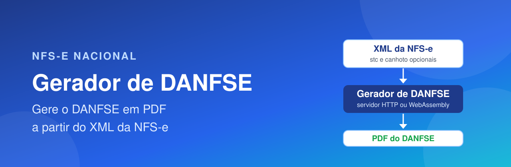

<p align="center">
  
</p>

<p align="center">
  <a href="https://github.com/nathanramorim/calculadora-rtc-gerador-danfse/tags"></a>
  
  
  
  
</p>

<h3 align="center">Gere o DANFSE em PDF<br>a partir do XML da NFS-e</h3>

---

## O que é

O Gerador de DANFSE é um serviço que recebe o XML de uma NFS-e (Nota Fiscal de Serviço eletrônica) e devolve o DANFSE em PDF, que é a versão para leitura e impressão da nota. Ele segue as especificações do padrão nacional da NFS-e.

Funciona de duas formas, com a mesma lógica: como serviço HTTP e como WebAssembly, para rodar no navegador. É mantido pela Receita Federal do Brasil, com o SERPRO.

## Por que usar

| | |
|---|---|
| **Um passo só** | Você envia o XML e recebe o PDF. |
| **Sem navegador nem HTML** | O PDF é desenhado direto pelo serviço. |
| **Dois jeitos de usar** | Servidor HTTP ou WebAssembly, com o mesmo resultado. |
| **Situação e canhoto** | Marca a nota como válida, substituída ou cancelada, e mostra ou oculta o canhoto. |
| **Entrada protegida** | Limite de tamanho do XML e rejeição de DTD e entidades. |
| **Pronto para operar** | Logs em JSON, verificação de saúde e telemetria opcional (OpenTelemetry). |

## Antes de começar

- **Go 1.27 ou mais novo**. Confira com `go version`.
- [Task](https://taskfile.dev/): opcional, mas recomendado.
- **Docker**, só se quiser rodar em contêiner.

## Instalação

```bash
git clone https://github.com/nathanramorim/calculadora-rtc-gerador-danfse.git
cd calculadora-rtc-gerador-danfse
```

Para gerar a imagem Docker (na raiz do projeto):

```bash
docker build -t danfse-go .
```

## Como usar

Inicie o servidor. Com Task:

```bash
task run
```

Sem Task:

```bash
go run ./cmd/danfse
```

Ele usa a porta `8080`. Para outra porta: `SERVER_PORT=8081 go run ./cmd/danfse`. Em contêiner: `docker run -p 8080:8080 danfse-go:latest`.

Com o servidor em execução, gere um PDF:

```bash
curl -X POST "http://localhost:8080/api/danfse" \
  -H "Content-Type: application/xml" \
  --data-binary @/caminho/para/documento.xml \
  -o danfse.pdf
```

Parâmetros opcionais:

- `stc`: situação da nota. `0` válida, `1` substituída, `2` cancelada.
- `canhoto`: `true` por padrão. Use `false` para ocultar o canhoto.

```bash
curl -X POST "http://localhost:8080/api/danfse?canhoto=false" \
  -H "Content-Type: application/xml" \
  --data-binary @/caminho/para/documento.xml \
  -o danfse.pdf
```

A documentação interativa (Swagger) fica em <http://localhost:8080/api/swagger-ui/index.html>.

### Configuração

| Variável | Padrão | Para que serve |
|---|---|---|
| `SERVER_PORT` | `8080` | Porta do servidor. |
| `LOG_LEVEL` | `info` | Nível de log: `debug`, `info`, `warn` ou `error`. |
| `XML_MAX_SIZE_BYTES` | `5242880` | Tamanho máximo do XML (5 MiB). O teto é 32 MiB. Valor inválido impede o início. |
| `OTEL_SDK_DISABLED` | `true` | Use `false` para ligar a telemetria (traces e métricas OTLP). |

As demais variáveis `OTEL_*` e os detalhes de logs, verificação de saúde (`/health/live` e `/health/ready`) e telemetria estão no [README anterior](README.antigo.md).

### Testes e build

```bash
task check      # go fmt e go vet
task test       # go test -race -count=1 ./...
task coverage   # cobertura e relatório coverage.html
task build      # binário em bin/danfse-service
```

## Segurança e privacidade

- O serviço rejeita XML com DTD ou entidades e limita o tamanho da entrada.
- Os logs nunca guardam o XML, o PDF, a querystring, identificadores fiscais nem cabeçalhos de autenticação.
- Erros internos (`5xx`) respondem com mensagem genérica.
- Para relatar uma falha de segurança, veja [SECURITY.md](SECURITY.md).

## Versões

| Versão | Novidades |
|---|---|
| 1.0.0 | Primeira versão: geração do DANFSE em PDF a partir do XML da NFS-e, por HTTP e por WebAssembly. |

O [CHANGELOG](CHANGELOG.md) ainda não registra a 1.0.0.

## Para quem quer contribuir

Sugestões e relatos de erro entram pelos canais do repositório. Veja o [guia de contribuição](CONTRIBUTING.md) e a [governança](GOVERNANCE.md).

## Licença

[MIT](LICENSE)
