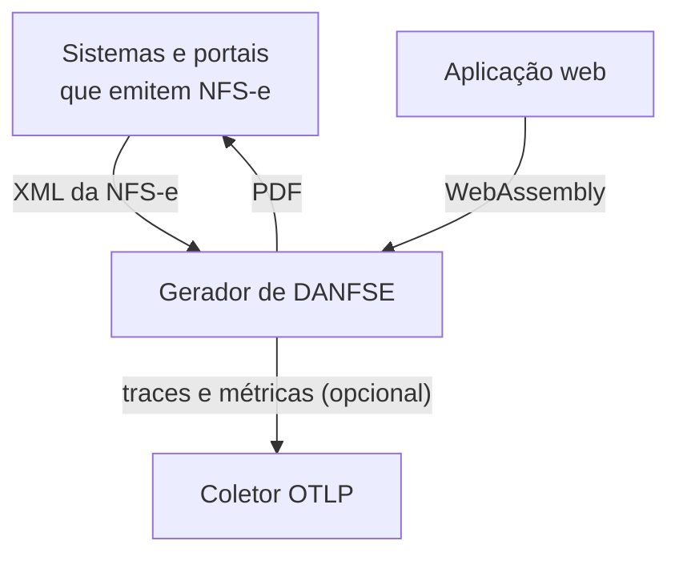
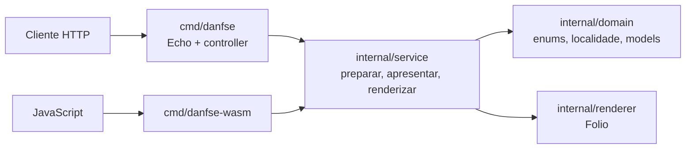

# Overview — calculadora-rtc-gerador-danfse

Serviço em Go, mantido pela Receita Federal e pelo SERPRO, que gera o DANFSE em PDF a partir do XML de uma NFS-e Nacional. O mesmo núcleo roda como servidor HTTP e como WebAssembly. Não usa banco de dados nem navegador: o PDF é desenhado direto com Folio e o catálogo de localidades vai embutido no binário.

## Índice
- `stack.md` — tecnologias e layout
- `modules.md` — componentes
- `flows.md` — fluxos principais
- `decisions.md` — decisões e índice de ADRs
- `concepts.md` — um conceito, uma casa (`DUP-01`)

---

## Arquitetura (C4 Model)

### Nível 1: Contexto

### Nível 2: Containers

